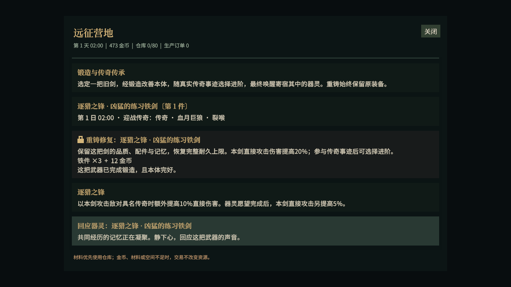
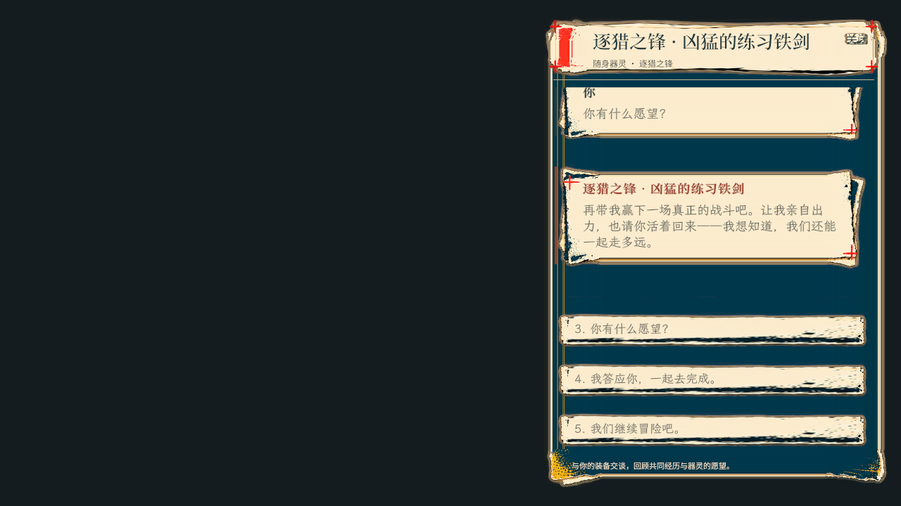
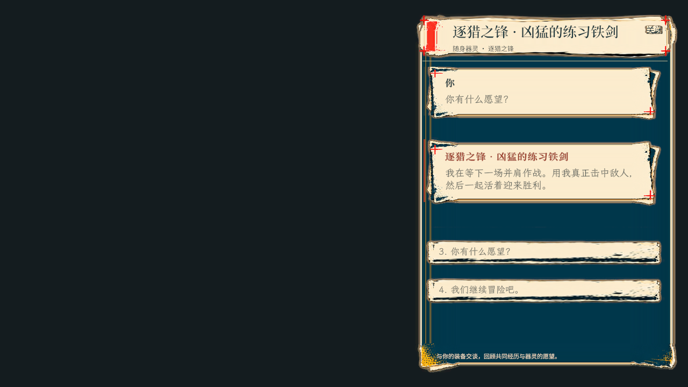

# 装备锻造首版交付与验证

2026-10-26。实现契约见 [装备锻造与随身器灵](../ForAI/Business/EquipmentForging.md)。

## 游玩入口

在大地图打开营地，建设一级工作台，在“锻造”分类选择练习铁剑101或铁剑40，消耗3铁件及12金币完成初次锻造。铁剑也可通过既有营地生产获得。成长始终附着在该武器实例上。

持剑参与击败真实具名传奇，或持剑见证传奇对话和解并完成对应委托，再返回营地选择“逐猎之锋”或“守望之锋”。回应器灵后可交谈、回顾事迹并接受第一次同行之约；随后以该剑实际参战、持有者存活且仍持剑获胜，即完成愿望。

当前接入既有具名传奇与701–703传奇委托；没有新增巨龙、守城任务或更高阶愿望链。器灵人格和愿望按路线配置，具体经历来自真实事件；未接入自由生成对白。

## 本轮实际检查

| 检查 | 结果与范围 |
| --- | --- |
| 配置导出 | `node Tools/ConfigEditor/exporter.mjs` 成功；三张新表、语言表及清单按正式管线生成。 |
| 核心成长规则 | `equipment_forge_core.lua` 通过；真实导出配置、事迹门槛、原武器任务归因、和解见证、重复结算、旧按钮、掉地后重拾补记、快照命令和无效存档配置。 |
| 战斗贡献与收益 | `equipment_legacy_combat.lua` 通过；实际Skill/GameEffects、削甲贡献、武器实例快照、真实传奇身份、主副手、损毁、GM/第三方排除、愿望资格、首轮护卫。C#边界使用隔离替身。 |
| 器灵对话 | `equipment_spirit_dialogue.lua` 通过；实例身份、场景/归属/存活门禁、版本、记忆、愿望一次接受、完成回应和缓存重开。 |
| 相关回归 | `legendary_equipment_core.lua`、`dialogue_interjections.lua`、`animal_speech_core.lua` 通过。 |
| 本地化 | `ui_localization_sources.mjs` 通过；新通用文字来自Language/LuaTxt，路线、性格、愿望来自配置text字段。 |
| C# 编译 | 本轮主动请求一次Unity刷新/编译，完成后控制台无error；真实新Data和器灵会话类型可被执行工具读取。 |
| 真实 C# 状态与保存 | `equipment_legacy_data.ps1` 对本轮已编译的Assembly-CSharp.dll通过五组检查：原子支付/所有权/版本、同对象重铸/阶段、装备与容器Capture/Prepare、旧档全部武器路径迁移/新档损坏拒绝、战斗临时证据。 |
| 原生UI集成 | `equipment_forge_editmode.cs` 执行 `equipment_forge_integration.lua` 通过。隔离PreviewScene、UIHost、FrameworkServices、独立LuaEnv及真实Camp/Dialogue Prefab按钮，验证资源/耐久/ID、事迹到觉醒、旧命令、愿望、关闭/Back/缓存重开和暂停释放。 |
| 文档 | 本模块与入口的本地链接检查通过。 |

原生UI检查使用轻量demo适配器调用真实业务命令；没有通过 `AdventureRuntimeDemo` 的C#输入门禁驱动完整游戏。测试直接记录一次真实C#事迹以进入UI阶段，实际战斗归因由战斗定向测试覆盖。未启动Editor、未进入Play、未运行全量测试或完整构建，也未读取或修改玩家存档。预览结束恢复原场景、dirty状态、语言服务、时间倍率和Unity随机状态。

另执行过旧 `legendary_traits.lua`，在 `InjuryRules.lua:42` 初始化时因其测试夹具缺少 `BodyHealth` 失败；该旧夹具本轮未修改，不将该项列为通过。

## 原生界面预览

## 验证入口

- [核心规则测试](../Tools/Tests/equipment_forge_core.lua)
- [战斗归因测试](../Tools/Tests/equipment_legacy_combat.lua)
- [器灵对话测试](../Tools/Tests/equipment_spirit_dialogue.lua)
- [真实Data与保存测试](../Tools/Tests/equipment_legacy_data.ps1)
- [原生UI执行脚本](../Tools/Tests/equipment_forge_editmode.cs)与[Lua集成检查](../Tools/Tests/equipment_forge_integration.lua)
