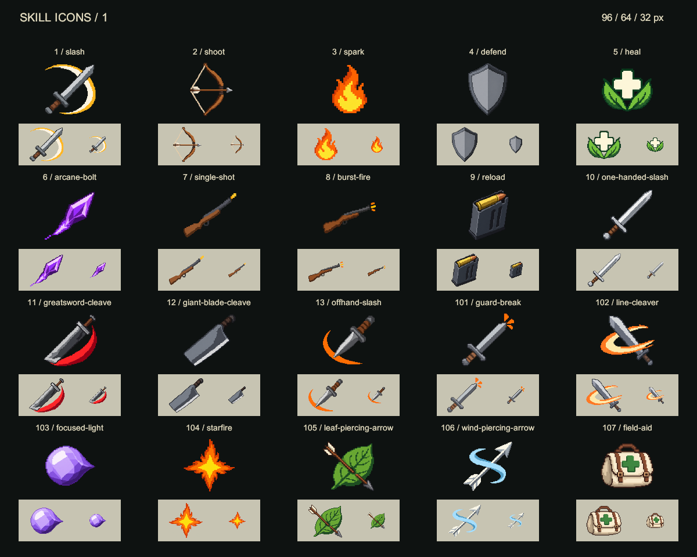
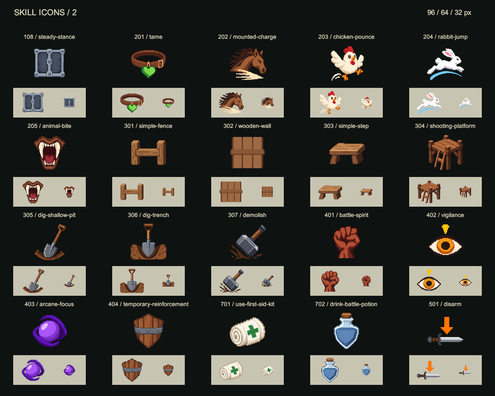
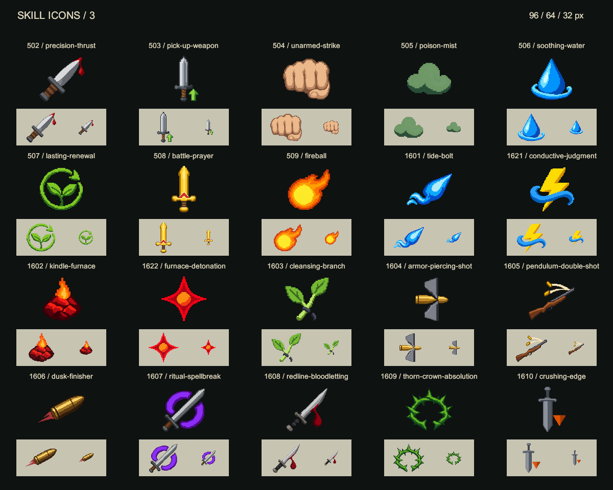
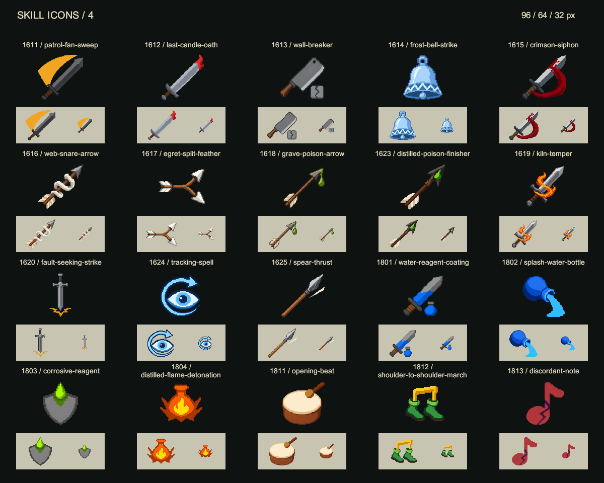
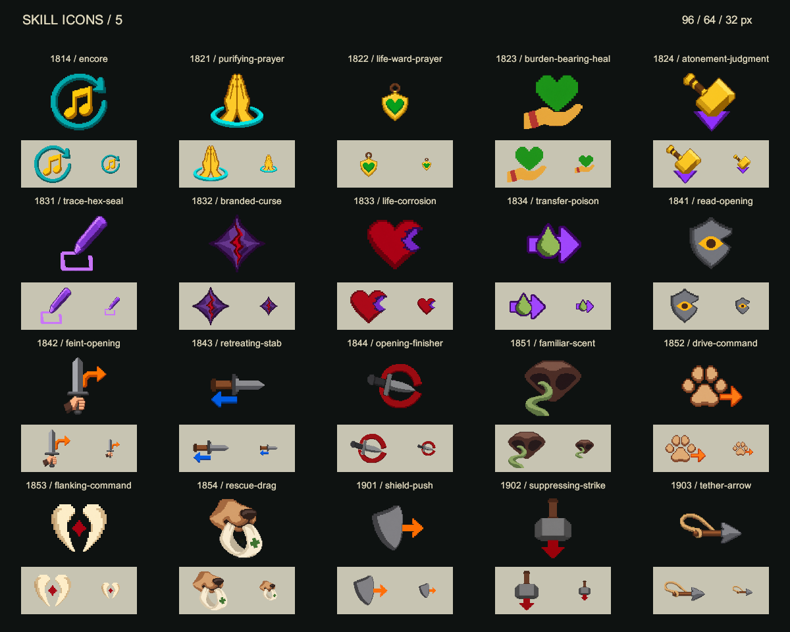
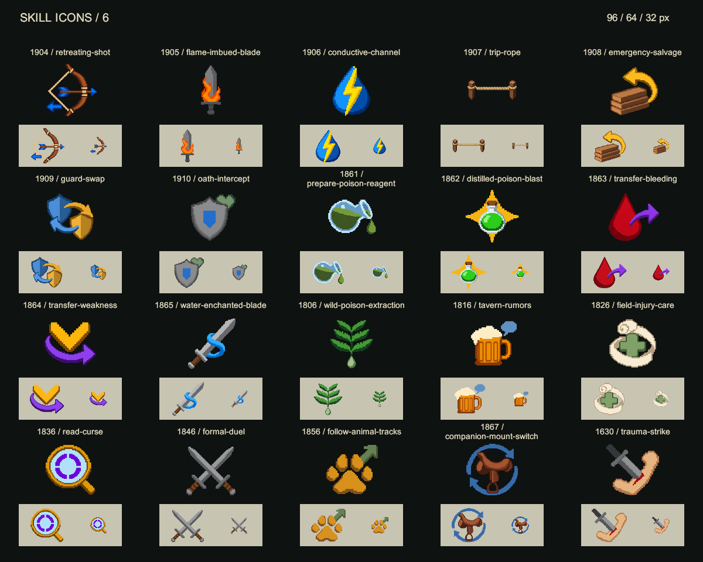
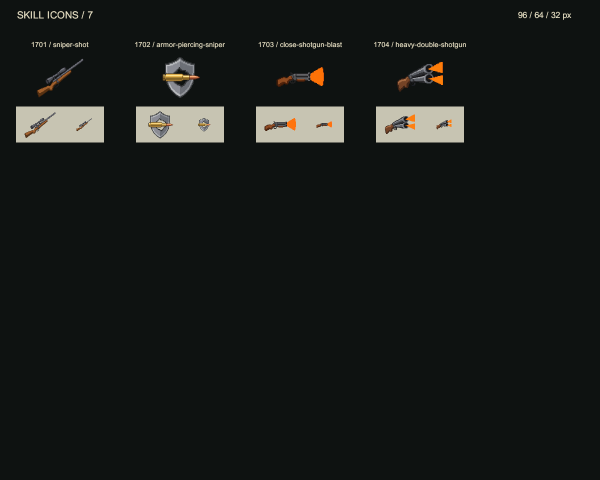

# 技能图标总览

2026-10-25：本轮确认的 124 个技能均已生成、发布、导表并绑定到战斗 HUD。以下预览来自实际 Unity Sprite，依次显示 96、64、32 像素与深浅背景。

[风格规范](../../../ForAI/Business/SkillIconArt.md) · [生产管线](../../../ForAI/Tools/SkillIcons.md) · [验证记录](../../../Art/SkillIcons/validation-all.json)

图中使用稳定技能 ID 和资源 slug 便于对照配置；游戏内名称仍取 CombatSkillTable 的本地化文本。

## 第 1 页

## 第 2 页

## 第 3 页

## 第 4 页

## 第 5 页

## 第 6 页

## 第 7 页

