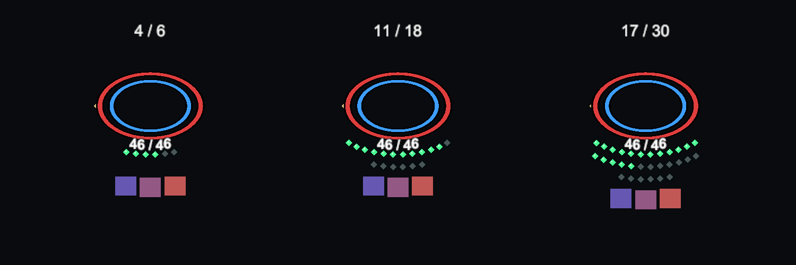

# 职业深度与施法点迭代

2026-10-27。实现于现有工程；新增45个主动技能，总技能数由145增至190。单职业自身能形成前置和连招，兼职可复用状态，不添加“从未兼职”或当前职业身份门槛。

## 职业新增技能

| 职业 | 新技能 | 延伸方向 |
| --- | --- | --- |
| 战士 | 破甲猛击、浴血雄心、裂阵终斩 | 护卫转进攻、破甲与流血收割 |
| 游侠 | 钉足箭、猎物印记、追猎连射 | 精准／追踪、射击控制与流血联动 |
| 法师 | 爆裂火球、落石术、水流术、陨石术、迷雾术、泥沼术、熔星术、静心回路 | 施法点投入、元素配方、区域控制与回复 |
| 巧匠 | 伤足绊索、铆接护具、震荡铆钉 | 真实材料、地面机关与工事拆修 |
| 骑士 | 震慑盾击、守阵誓约、荣光裁断 | 护卫换位、守命保护与重击 |
| 炼金师 | 燃油瓶、速凝解毒、催化爆裂 | 药剂材料、潮湿／燃烧／毒的准备与消费 |
| 吟游诗人 | 回声短句、静谧挽歌、裂帛终章 | 战中获得余音，再消费为攻势或支援 |
| 神官 | 惩戒圣言、苦难代祷、圣约归还 | 护符资源、净化、治疗与牺牲式支援 |
| 咒术师 | 血字刻印、疫病咒缚、血契收割 | 咒印、负面状态消费与转祸 |
| 决斗家 | 缝隙刺、追隙连刺、回锋守势 | 破绽制造、近战追击与流血终结 |
| 驯兽师 | 安抚舔伤、猎群振奋、合猎刺伤 | 真实动物伙伴的辅助、恢复与协同 |
| 农民 | 弯镰断步、田野喘息 | 生活经验转为战斗续航与防护 |
| 贵族 | 整队号令、决断宣言 | 领导、支持和战术协作 |
| 奥术骑士 | 符刃回环、星盾折返、双相断奏 | 奥术触媒与近战附刃循环、状态收割 |

## 法师实际规则

基础施法上限6点，本人正式回合开始回复1点；非战斗每10游戏分钟回复1点。天赋和指定装备可增加上限、回合回复与非战斗回复速率。点数、小数回复进度随角色存档；换装不补满，战后不补满。AP仍单独消费。

| 法术 | 基础施法点 | 额外投入上限 | 自动组合条件 |
| --- | ---: | ---: | --- |
| 爆裂火球 | 2 | 3 | 普通课程 |
| 落石术 | 2 | 3 | 普通课程 |
| 水流术 | 1 | 2 | 普通课程 |
| 陨石术 | 5 | 3 | 爆裂火球 + 落石术 |
| 迷雾术 | 3 | 0 | 爆裂火球 + 水流术 |
| 泥沼术 | 3 | 0 | 落石术 + 水流术 |
| 熔星术 | 7 | 3 | 陨石术 + 群星之火 |
| 静心回路 | 0 | 0 | 普通课程 |

额外每点默认提高25%伤害，在战斗栏选中法术后用±调整；合法施放未命中也支付资源。掌握配方所需技能后自动开放组合，不另花学习机会。静心回路消耗2次要AP、回复3点、冷却3回合。

陨石和熔星包含敌我范围伤害并留下3轮燃烧危险区；迷雾施加潮湿、熄灭重叠火区并阻断超过1格的射线；泥沼施加迟缓。火区与泥沼额外消耗1格移动距离。它们是有实际规则的战斗区域，战后清理，不作为永久地图建筑。

## UI与表现

施法点位于脚下生命环与Buff弧之间：绿色可用、灰色已耗，每弧12点，自动向外换行并为Buff留出间距。角色状态、战斗栏、技能Tips均显示资源。新增技能均有独立特效配置，旧技能同步增强亮度与粒子层次；陨石使用20面低模实体、下坠拖尾、爆裂和余焰，世界特效使用HDR颜色与有预算的短时点光。

[真实法术特效预览](Previews/Spellcasting/skill-effects-contact-sheet.png)

## 实际验证

- 配置导出219张表通过；职业学习8组、职业战斗13组、图鉴完整性、技能特效覆盖、本地化和施法点离线规则/UI检查通过。
- 主动集中触发1次Unity编译，随后资源和UI类型可用；没有本轮编译错误。编辑器自身自动刷新不计作受控编译。
- 已在隔离Edit Mode执行真实C#资源／存档检查、真实Lua战斗入口联调、21组点数mesh／Prefab绑定检查，以及陨石阶段／点光预算／粒子回收检查。
- 已保存原生Prefab绑定，渲染并查看两张预览；测试创建的PreviewScene与资源均清理，未进入Play，未运行全量测试。真实长局平衡和实际战场视觉仍待Play体验。

规则与修改入口：[施法资源模块](../ForAI/Business/Spellcasting.md)。

## HUD接入修复

2026-10-27实机反馈暴露此前检查漏掉了说明卡初始化：45个新增技能缺少同ID的 `SkillDescriptionTable` 行，导致HUD在2301处失败。现已补齐全部45行正文与标签并导表；真实 `SkillTipCatalog/SkillTipModel` 已成功构建190张说明卡，覆盖施法点加码与组合配方。内容校验改为覆盖全部当前技能，避免历史清单之外的新增技能再次漏检。当前Lua配置不支持热重载，运行中的旧缓存需重新进入Play后读取新表。
