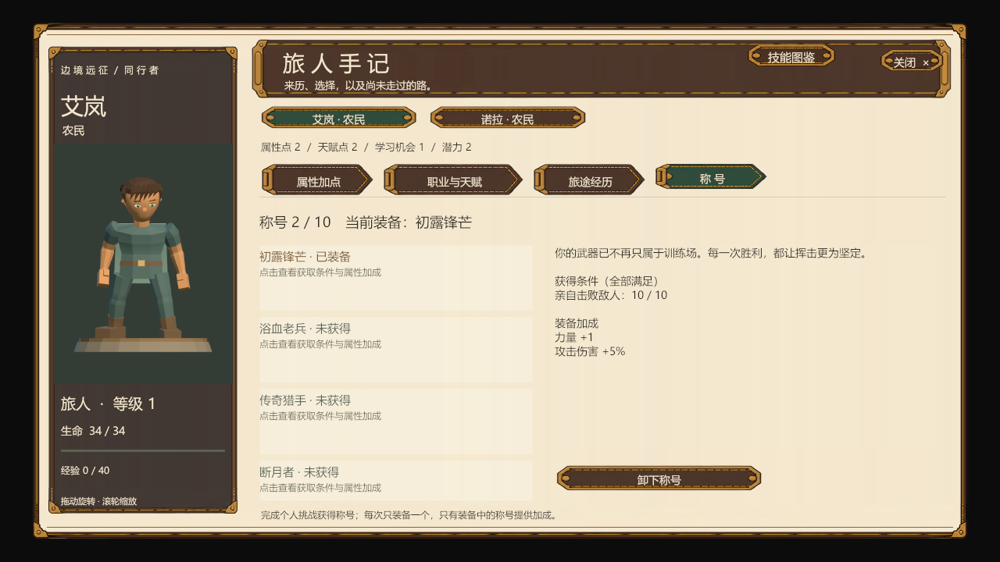

# 授勋、称号与士气首版

十个称号已写入配置。称号永久归角色所有，获得后由玩家在角色手记的“称号”页装备；同时只装备一个，未装备的称号不叠加数值。以下是首版平衡值，运行以 [TitleTable](../Config/Tables/Progression/TitleTable.json) 与 [TitleRequirementTable](../Config/Tables/Progression/TitleRequirementTable.json) 为准。

| 称号 | 获得条件 | 装备加成 | 设计方向 |
| --- | --- | --- | --- |
| 初露锋芒 | 本人累计击败10名敌人 | 力量+1，攻击伤害+5% | 早期攻击收益 |
| 浴血老兵 | 本人累计击败50名敌人 | 防御+2，勇气+2，攻击伤害+10% | 持续作战、攻守兼顾 |
| 传奇猎手 | 本人击败任意1名传奇敌人 | 勇气+2，攻击伤害+15%，士气上限+5 | 高攻击收益 |
| 断月者 | 本人击败血月巨狼·裂喉 | 速度+2，勇气+3，攻击伤害+5%，士气上限+10 | 先手与士气稳定 |
| 破誓之刃 | 本人击败叛誓剑士·维兰 | 防御+3，攻击伤害+10%，士气上限+5 | 前线攻防 |
| 驿路守望 | 在队期间完成“失踪的驿使” | 防御+1，魅力+1，士气上限+10 | 剧情起步奖励 |
| 践诺者 | 在队期间累计完成5项任务 | 勇气+2，士气上限+10 | 提高承压能力 |
| 众望所归 | 在队期间累计完成20项任务 | 魅力+3，勇气+3，士气上限+15 | 社交与高士气容量 |
| 委托能手 | 在队期间累计完成10项城镇委托 | 耐力+2，魅力+2，士气上限+5 | 劳务、装备门槛与社交 |
| 护命者 | 本人完成3次真实危急救援 | 防御+2，勇气+3，士气上限+10 | 救援角色的生存与承压 |

任务完成时，所有在队成员各记一次，包括倒地成员；后加入者不补算。累计任务包括剧情Mission和城镇委托，不包括中间Quest阶段。传奇击杀必须由该角色完成；通过对话和解可以完成相关剧情任务，但不会产生传奇击杀记录。危急救援复用现有规则：正式战斗中治疗生命不高于25%的其他参战队员，且产生真实治疗量；每场同一角色对只计一次。

配置还支持指定普通敌人、指定任务阶段、指定城镇委托模板，以及多项条件的“全部满足／任一满足”。首批内容采用易于理解的单项条件，后续组合无需新增授勋逻辑。

## 士气规则

- 基础勇气40，角色原有属性、加点、装备及称号在其上叠加。士气上限＝50＋勇气＋当前称号的额外士气上限。勇气加成同时提高容量与检定；单独的上限加成只提高容量。
- 开战士气为上限的75%，向下取整。士气为战斗临时状态，战后恢复为下一场的初始语义；血条外围白环显示当前值／上限。
- 勇气检定使用战斗随机流，掷1–100：成功率＝勇气＋阶段修正＋邻近友军数×5－邻近敌人数×3－事件难度，限制在5%–95%。邻近范围1格；目睹倒地／溃逃的范围4格。
- 单次损失至少15%最大生命时进行重伤检定。负面事件检定失败才扣士气；正面事件检定成功才增加士气。

| 状态 | 士气比例 | 命中／防御倍率 | 检定修正 |
| --- | --- | --- | --- |
| 自信 | ≥90% | ×1.1／×1.1 | +10 |
| 稳定 | ≥60%、<90% | ×1／×1 | 0 |
| 动摇 | ≥40%、<60% | ×0.9／×0.9 | −10 |
| 崩溃 | ≥20%、<40% | ×0.8／×0.8 | −15 |
| 逃跑 | <20% | 禁止自主行动／×0.7 | −20 |

| 事件 | 难度（从成功率扣除） | 生效时士气变化 |
| --- | --- | --- |
| 承受重伤 | 0 | −20 |
| 目睹同伴倒下 | +10 | −25 |
| 目睹同伴逃跑 | 0 | −15 |
| 目睹敌人倒下 | −10 | +8 |
| 亲自击败敌人 | −20 | +15 |
| 回合开始时寡不敌众 | +5 | −10 |
| 拉开距离后重整 | −20 | +20，至少恢复到动摇下限 |

逃跑角色自动选择远离敌人的合法可达格，承受正常借机攻击后结束回合。受击后移动范围变化会重新选格；无合法远离方向时留在原地结束回合。距最近敌人超过1格才尝试重整。逃跑不会直接删除角色或产生击杀奖励，当前沿用战场边界与最大回合规则。

## 实现与验证

接口、存档迁移、配置来源和实际验证范围见 [模块文档](../ForAI/Business/TitlesAndMorale.md)。已完成导表、规则单测、真实配置与C#数据集成、任务领取和保存回读、自动逃跑与借机攻击，以及实际称号页按钮检查。未进入Play，首版数值仍需实际游玩评估。

