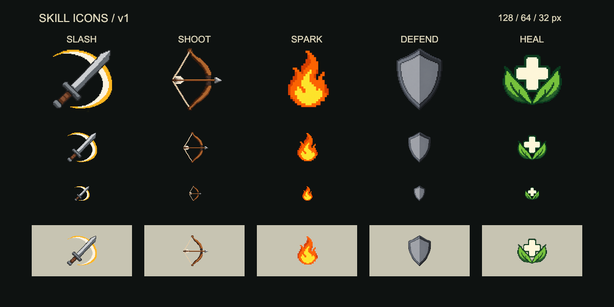

# 技能图标美术风格
关键词：技能图标风格、简洁像素、低细节、直观、大色块、图标验收、pixel-simple-v1。

## 文档目录
正文：基准与适用范围 / 画面规则 / 图意与区分 / 生成与验收；关键入口：参考图 / 配置 / 管线。

## 正文

### 基准与适用范围

- 目标是小尺寸下直观、干净的奇幻技能图标。**少细节优先于精致装饰**；画面只保留辨认技能所需的信息。不是把复杂插画缩小或加像素滤镜。
- 已认可基准为下方首批五张：斩击、射击、火花、防御、治疗。继续制作时对齐其主体占比、色块密度与轮廓可读性；不向写实、厚涂、发光特效或精密装备立绘漂移。
- 本规范用于技能 Sprite 的生成、返修与美术验收。事件插画、物品模型截图、属性/天赋字符符号和游戏内 VFX 分别遵守其所属模块。

### 画面规则

| 项目 | 要求 |
| --- | --- |
| 构图 | 一个主体，最多一个辅助动作/效果；主体居中，约占画幅 75%，四周留透明安全边距，不切边。 |
| 轮廓 | 先靠外轮廓认出剑、盾、弓、火、药剂等主体；必要结构画粗，避免细线、密集尖刺、细网格。 |
| 像素感 | 约 64×64 的逻辑像素，边缘有清楚的阶梯，大块连贯；允许轻度像素感，不要求输出文件本身只有 64 像素。 |
| 色块 | 以 8–12 种以内的可感知主色为目标。每种材质最多基础色加一层阴影；不靠细碎颜色变化表达材质。 |
| 明暗 | 大面明暗，少量结构分面即可。暗底上必须看见实心主体，不能只剩一圈细描边；深铁色武器可用中灰保证读形。禁止镜面高光、反光条、环境反射、柔光、渐变光晕。 |
| 背景 | 真实透明；无底板、边框、徽章外圈、场景、地面投影或伪透明棋盘。图意必需的环/盾形本体不算 UI 外框。 |
| 细节 | 禁止金属/木纹纹理、磨损、噪点、颗粒、碎屑、粒子、密集花纹、文字、数字与水印。 |

色数与像素网格是视觉约束，不把模型生成 PNG 的逐像素颜色数量当作“严格索引色”承诺。资源按 [管线](../Tools/SkillIcons.md) 保存原图并导入；不得用后期锐化、发光或纹理补偿图意不清。

### 图意与同类技能区分

- **先画动作或功能，再画名称里的修辞。** 例如缴械用下落的武器，拾取用向上的武器，追踪用眼睛和单条弯曲指向；不要因传奇名称给图标添加人物、祭坛或复杂故事场景。
- 武器类用刀刃宽度、长短、方向与单条动作轨迹区分：短剑/单手剑/大剑/巨刃/长枪应先有不同轮廓；横扫与下劈用不同轨迹，不只换颜色。
- 武器形制核对实际装备配置。当前点射、连射与钟摆双发来自 `gunClass=rifle` 的双手枪，使用简化木托步枪；不要生成现代半自动手枪、战术附件或枪身细密零件。
- 法术类用紧凑符号：火焰、水滴、闪电、毒雾、晶体等。需要表示状态组合时，只加一个粗大的辅助符号，不能堆多个效果。
- 治疗/恢复优先用十字、叶片、绷带、药包；建造优先画实际栅栏、墙、台阶、平台或工具；动物动作保留动物特征和至多一条动作弧。
- 同族技能可保留统一配色，但必须至少有一个可在 32 像素辨认的轮廓或方向差异。不能把共用剑/盾图标换个色就当作所有技能的最终图标。
- 技能含义以 `CombatSkillTable` 和对应配方为准。语义不确定先核实规则；改图不改变战斗效果、消耗或技能身份。

### 生成与验收

1. 从 `SkillIconRecipeTable` 读取对应 `subject`，从 `SkillIconStyleTable` 读取风格提示；由 `prepare` 拼出完整 job。每个技能独立生成一张，不通过一张大图切割得到多张技能资源。
2. 使用内置 `image_gen` 且 `transparent_background=true`。直接沿用 job 的提示词；返修若改变主体设计，应先改配方并重新准备，完整记录新提示词与版本。
3. 先看 64 和 32 像素，再看较大预览。检查：主体一眼可认；相邻同类技能能区分；辅助效果不抢主体；深浅背景都不露底、杂边或假棋盘；没有多余细节。
4. 不合格时按问题简化：删装饰、减辅助元素、放大主体、加粗关键结构、调整轮廓。不要用更多高光、颜色和粒子“增强表现力”。
5. 视觉确认后发布，保留原图和历史版本；Unity 中复查实际 Sprite 与 HUD 绑定。格式、hash 和引用校验不能替代美术验收。

## 关键入口

- [首批认可预览](../../Docs/Previews/SkillIcons/first-five.png)：继续生成和返修的视觉基准。
- [风格表](../../Config/Tables/Adventure/SkillIconStyleTable.json)：提示词与导入尺寸的唯一配置源；当前使用 `pixel-simple-v1`。
- [配方表](../../Config/Tables/Adventure/SkillIconRecipeTable.json)：逐技能主体设计；主体限制与本规范一致。
- [技能图标生成管线](../Tools/SkillIcons.md)：任务准备、发布、版本、导表和 Unity 同步。
